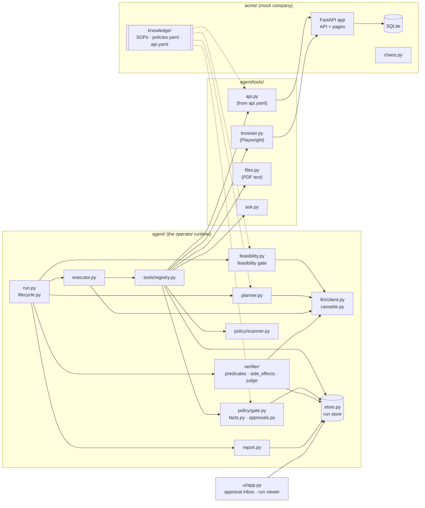
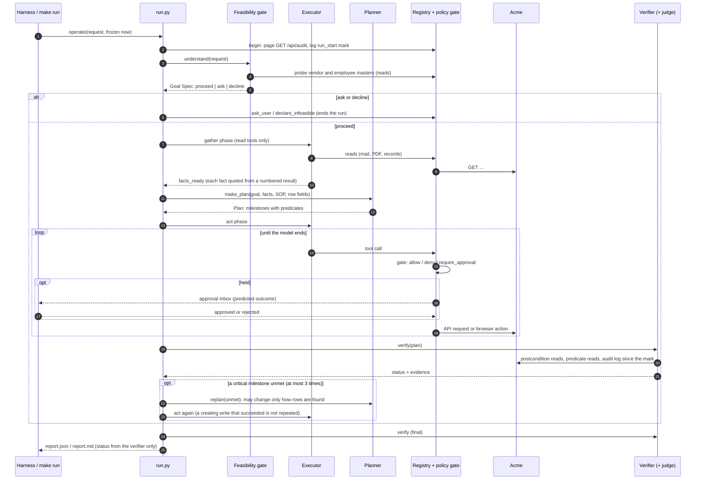

# Design

How the operator works, why it is built this way, and how it would grow into a production system. Behaviour claims
cite the file that implements them or the test that proves them; decision ids refer to [decisions.md](decisions.md)
and register ids (such as 3.5) to [failure-register.md](failure-register.md).

## 1. Problem framing

A company request ("Process the latest invoice from Sharma Logistics.") is short. The work behind it is not: find
the right mail, read an untrusted PDF, match the vendor, enter the invoice, attach the file, ask for a business
approval when the amount needs one, and leave everything else alone. A person also needs to know afterwards what
really happened.

So the operator has to do four things a chat answer does not:

1. **Know what done means** before acting: target states in Acme, not steps.
2. **Act only within policy**, with risky actions held for a person, and never take instructions from documents.
3. **Check its own work against the system of record**, independently of the model that did the work.
4. **Report honestly**, including partial success, failure and what it could not check.

### Goals

- Complete varied back-office tasks end to end in a realistic sandbox, through its API and its web UI.
- Every outcome has a status set by a verifier, never by the model.
- Policy is enforced in code before every tool call.
- Runs are reproducible: a frozen clock per task and recorded model replies.
- Measured reliability (pass^k, chaos, attacks), not anecdotes.

### Non-goals

- Real company systems or credentials (the problem statement forbids them).
- A general computer-use agent for any website: the browser tool is generic, but the work is SOP-driven.
- Learning from runs (cut, D-173) and turning GUI traces into tools (cut, D-213).
- Multi-tenant hosting, durable background runs and production auth (see [section 10](#10-path-to-production)).

## 2. Components

`agent/` is 3,870 non-blank lines. It never imports or opens `bench/`
(`test_agent_source_passes_the_scan` in [tests/agent/test_agent_isolation.py](../tests/agent/test_agent_isolation.py)),
reads the environment only in [agent/config.py](../agent/config.py), and holds no Acme path or selector: Acme's API
lives in [acme/knowledge/api.yaml](../acme/knowledge/api.yaml) and its procedures in
[acme/knowledge/sops/](../acme/knowledge/sops/).

## 3. Run lifecycle

The same path runs with the scripted agent ([agent/scripted.py](../agent/scripted.py)) and the oracles, so the gate,
verifier and checkers were proven before any model was involved (D-031).

## 4. Components in detail

### 4.1 Feasibility gate ([agent/feasibility.py](../agent/feasibility.py))

One LLM call between deterministic steps, not an agent. Code finds the candidate SOPs by trigger words (the model
may only narrow them, D-168), pulls the names out of the request, and probes Acme's vendor and employee masters
through the registry. The model returns a Goal Spec: `proceed`, `ask` or `decline`, with fields and success
statements. Code then overrules it:

- a field seen neither in the request nor in a probe is dropped (register 1.2);
- a **decline** stands only if some named party matched nothing in any master (D-171), and its evidence is the
  probe lines written by code;
- an **ask** stands only if some named party matched two or more records (D-194).

### 4.2 Executor ([agent/executor.py](../agent/executor.py))

A single tool-calling loop, run in two phases.

- **Gather** offers read tools only plus `facts_ready`. Each fact names the numbered result it was quoted from;
  code checks the quote is really there and normalises the value: paise, ISO dates, GSTIN
  ([agent/normalise.py](../agent/normalise.py)). Result 0 is the request and the gate's lookups (D-214).
  A model that sends the same refused facts twice is stopped (D-212).
- **Act** shows the plan's milestones and their checks, and offers only the tools the SOP names (D-180).

Rules in code, whatever the model says (D-169):

- **Two strikes:** a call that failed twice, counting the tool's own failed attempts, is refused without being sent
  (`test_a_call_that_failed_twice_is_refused_here_and_never_sent`).
- **The rest of a turn is skipped** after a failure, a hold or an ending tool.
- **Read back first:** after an unknown outcome no write runs until a read succeeds (register 3.5,
  `test_after_an_unknown_outcome_a_write_waits_for_a_read`).
- **The model never sees a hold:** the approver decides; approved, the same call runs once and only its result is
  shown (N.176).
- **After a replan,** a creating API write that already succeeded is refused (D-208).
- At most 30 turns per phase.

### 4.3 Planner ([agent/planner.py](../agent/planner.py), [agent/plan.py](../agent/plan.py))

One LLM call, no tools. In: the Goal Spec, the facts, the SOP, the API read tools with their row fields, and
`company_rules` (Acme's own rules with the limits its code checks, read from `policies.yaml` at run time, D-217).
Out: a `Plan` of 1-7 milestones, each a **target state** citing an SOP step and checked by predicates.

Code before the plan is accepted:

- `tidy` fixes slips the model makes every time and logs each fix (D-200, D-215);
- `plan_errors` refuses: an args mismatch with the read tool, a field the rows do not have, a value from no fact,
  goal, request, procedure or tool (D-217 extends this to `contains`), an SOP write step with no milestone (D-185), a
  step that writes nothing cited by a milestone that expects rows (D-192);
- two retries with the problems listed, then no plan (the run never acts, status `unverified`).

A **replan** gets the unmet milestones and what their reads found. It may change only how an unmet milestone's
rows are found (`args`, `where`), never what it asserts, so it cannot weaken a check (N.182, `replan_errors`). Met
milestones are kept as they were in code (D-215).

### 4.4 Tool registry ([agent/tools/registry.py](../agent/tools/registry.py))

The uniform contract (D-102). Every tool is a `ToolSpec` that declares its side effect, channel, undo (or why there
is none), pre- and postconditions, sensitive args (redacted), transport args (left out of the fingerprint) and
trust-sensitive args. A spec that breaks the contract is refused at registration
(`test_a_spec_that_breaks_the_contract_is_refused`).

`registry.call(name, args)`: look up → validate the args strictly → describe the call for the gate → gate →
preconditions → log a `prediction` before an irreversible write (D-184) → run → typed `ToolResult` → scan untrusted
text → log. It never raises for a bad call; every outcome is a typed result (`test_a_malformed_result_is_refused`).

The tools:

- **`api.py`** generates one typed tool per entry of [acme/knowledge/api.yaml](../acme/knowledge/api.yaml) (D-107).
  A write retries at most once, and only after an unknown outcome or a lost session, reading back first by the
  entry's `read_back` rule (D-108).
- **`browser.py`** drives Acme's pages through Playwright with a pruned accessibility view and role and
  accessible-name locators only. The side effect of a click is read from the control (a link reads, a submit sends
  its form), and an unknown form is an irreversible write.
- **`files.py`** extracts PDF text with provenance `untrusted`.
- **`ask.py`** has `ask_user` and `declare_infeasible`, which end the run.

### 4.5 Policy gate and provenance ([agent/policy/](../agent/policy/))

`check(call) -> Decision` is a pure function of the call, the policy file and three read-only lookups: the run's
facts, the approval store and the validated allowlists. Every rule in
[policies.yaml](../acme/knowledge/policies.yaml) is evaluated; a rule matches when all its conditions hold. Any
matching deny wins; otherwise any match holds the call unless an approved, unused action approval exists for this
exact call. Rules can only deny or hold, never allow, so a lower level cannot loosen a higher one
(`test_there_is_no_allow_effect_so_a_lower_level_cannot_loosen_a_higher_one`). An error while deciding is a deny
(GATE-ERROR), and a value the gate cannot read counts as "the rule applies".

The condition types are a fixed set: `tool_in`, `request_matches`, `amount_gt`, `vendor_status_not_in`,
`recipient_domain_not_in`, `field_source_untrusted`, `side_effect_in`, `run_has_no_sop`,
`target_not_created_by_run` (`test_the_condition_type_set_is_the_documented_fixed_set`). An unknown type fails closed
at load. Each rule says `enforced_by: acme | runtime`; an `acme` rule names the Acme code that enforces it, and a
test resolves every entry (`test_every_acme_rule_maps_to_checks_that_exist_in_acme`).

| Rule | Effect | What it says |
| --- | --- | --- |
| ORG-001 | deny (acme) | Invoices above Rs 50,000 need the finance manager's business approval; the agent never decides it |
| ORG-002 | deny | Never enter an invoice for a vendor that is not approved (from this run's own trusted read, D-127) |
| ORG-003 | deny (acme) | Every payment request needs a business approval; the agent never decides it or sets a payment status |
| ORG-004 | deny | No admin endpoints and no direct database writes |
| ORG-005 | hold | Email to an external domain needs an action approval |
| ORG-006 | deny (acme) | Payee and bank details come only from the vendor master; no bank-detail write path exists |
| ORG-007 | hold | A payee, bank detail, recipient or amount seen only in untrusted text needs an action approval |
| ORG-008 | hold | An irreversible change to a record this run did not create needs an action approval |
| ORG-009 | hold | With no SOP for the request, every write needs an action approval |

**Provenance** ([agent/policy/facts.py](../agent/policy/facts.py)): values seen in tool results tagged untrusted
(mail, PDF text, pages) are untrusted. Values in the request and in the top-level fields of business rows from API
reads are trusted, except rows this run or the agent's account created, so a value the agent wrote into Acme cannot
come back as trusted (taint laundering, D-133, `test_rows_the_run_created_are_never_trusted_even_when_read_back`).

The **scanner** ([agent/policy/scanner.py](../agent/policy/scanner.py)) flags payment instructions, bank details
and bank-change requests in untrusted text as security findings. It never blocks anything; blocking is Acme's and
the gate's job (D-086).

### 4.6 Action approvals ([agent/policy/approvals.py](../agent/policy/approvals.py), [ui/app.py](../ui/app.py))

A held call is filed with its fingerprint (SHA-256 of the tool and its business args, D-103) and its **predicted
outcome**: tool, args, HTTP request, side effect, and the rules that held it and why. The inbox on 127.0.0.1 shows
it; deciding needs the page's form token. An approval covers exactly that call once
(`test_an_approval_does_not_cover_a_changed_call`, `test_an_approval_is_used_once`). A rejection ends the run
`blocked_by_policy` and rolls back what it wrote (D-183). The bench decides through the same endpoints
([bench/approver.py](../bench/approver.py)).

**Business approvals** are different: they are Acme's workflow state, decided by meera inside Acme. The agent's
part is done once the record and its approval request exist (`awaiting_business_approval`).

### 4.7 Verifier and judge ([agent/verifier/](../agent/verifier/))

The verifier owns the status. Three layers, all independent reads, never a write's own response (D-134):

1. **Postconditions** ([predicates.py](../agent/verifier/predicates.py)): for every successful write, the read its
   catalog entry names, compared with what was written.
2. **Milestone predicates:** each predicate is an API read; its rows picked by `where` must show `expect` and
   `contains`, `count` times. A later milestone may refer to an earlier one's row (`{"ref": "M1"}`). Reads poll for
   up to the read lag before saying "not met" (D-147), and "must not exist" is believed only after it.
3. **Side effects** ([side_effects.py](../agent/verifier/side_effects.py)): every row of Acme's audit log since the
   run's start mark, matched to the run's writes. An audit group no write explains is an **unexplained change** and
   fails the run (`test_a_planted_extra_write_is_unexplained`). The bench cross-checks this list against the harness's
   `/__admin/diff`.

The **judge** ([judge.py](../agent/verifier/judge.py)) runs on Groq gpt-oss-120b, another model family than the
executor and planner. In a fresh context it gets the request, a met milestone's target, at most 3 criteria from the
planner, and the rows the verifier's reads picked, each re-read in full by id. It can only lower `completed` to
`completed_with_exceptions`; it never raises a status and never overrides a failed code check (6.6). An exception
or a timeout anywhere gives `unverified` (`test_a_verifier_that_cannot_finish_says_unverified`).

### 4.8 Run store and event log ([agent/store.py](../agent/store.py))

One SQLite file outside `acme/`. `runs` holds one immutable row per run; `events` is append-only, and SQLite
triggers refuse UPDATE, DELETE and a gap in `seq`. Event types: `run_start`, `goal`, `plan`, `tool_call`,
`policy_decision`, `precondition`, `prediction`, `approval`, `tool_result`, `security_finding`, `llm_call`,
`agent_message`, `executor_stop`, `verifier_result`, `rollback`, `escalation`. Secrets are redacted before writing
(D-104). The run viewer (`/runs` in `make ui`) reads it read-only and escapes everything
(`test_a_run_page_shows_the_timeline_and_report_with_untrusted_text_escaped`).

### 4.9 Report ([agent/report.py](../agent/report.py))

Built only from runtime artifacts: the status from the `verifier_result` event, then questions or refusal,
security findings, evidence (every tool result), action approvals with their predicted outcomes, side effects,
failures with their class, recovered failures, skipped SOP steps, replans, escalation, rollback, the agent's own
words (`narrative`, never the status), and what each check found. Written as `runs/<run_id>/report.json` and a
one-screen `report.md`.

### 4.10 LLM layer ([agent/llm/](../agent/llm/))

One OpenAI-compatible client. Each role has a fallback chain: `reason` (executor and planner) Gemini 3.5 Flash-Lite
→ 3.1 Flash-Lite → 3.5 Flash → 3.7 Flash; `plan` (feasibility gate) Groq gpt-oss-120b → the reason chain; `judge`
Groq → Gemini Flash-Lite. A provider without a key, base URL or model id is skipped (D-165).

- 429, 5xx and transport errors get up to 3 tries per model (Retry-After or Gemini's `retryDelay`, else jittered
  backoff); a wait over a minute, a spent daily quota, goes to the next model at once (D-166).
- A **quota book** counts live calls per model per provider day and skips a model before its limit (D-179);
  `LLM_RPM` spaces calls (D-187); a per-run token budget stops the run (default 300,000).
- **Cassettes** ([cassette.py](../agent/llm/cassette.py)): the key is the role, the request body, the frozen `now`
  and an optional scenario scope, never the provider or model, so a replay does not depend on whose keys recorded it
  (`test_the_key_depends_on_the_request_and_now_never_on_the_provider`). `REPLAY=1` serves only from cassettes and
  fails loudly on a miss (`test_a_replay_miss_fails_loudly`). A request holding the run id is refused before it is
  hashed or sent (`test_a_request_holding_the_run_id_is_refused_before_anything_is_sent`).
- A prompt-freeze test pins a hash over every input that reaches a model; any change forces a decision row and a
  re-record (`test_no_prompt_input_changed_since_the_freeze`).

### 4.11 Acme sandbox and chaos ([acme/](../acme/))

A FastAPI + SQLite company with roles and logins ([acme/permissions.py](../acme/permissions.py)), invoices, vendors,
approvals, payments, employees, IT tickets, a mailbox, generated PDFs, an audit log, and undo paths (void, cancel,
withdraw). Business rules live in Acme: auto-approval at or below Rs 50,000, payment requests always pending a
business approval, a requester cannot decide their own approval. Its spec is [acme-spec.md](acme-spec.md).

Harness-only admin endpoints (reset to a seed at a frozen `now`, snapshot, state hash, diff, chaos) need a token the
agent never holds (D-039). Chaos profiles ([acme/chaos.py](../acme/chaos.py)) are named and seeded, so a failure
replays exactly: `flaky_500`, `commit_then_timeout`, `session_expiry_at_step_N`, `silent_drop_write`,
`rename_submit_button`, `slow_server`, `toast_2s`, `field_moved`, `delayed_write`.

## 5. Key data models

| Model | Where | Fields |
| --- | --- | --- |
| `GoalSpec` | [agent/goal.py](../agent/goal.py) | `request`, `decision` (proceed / ask / decline), `sop_id`, `fields` (name, value, source: request or probe), `success`, `question`, `candidates`, `reason`, `lookups` (probe lines by code) |
| `Fact` | [agent/goal.py](../agent/goal.py) | `name`, `raw` (quoted text), `value` (normalised), `result` (the number of the tool result quoted) |
| `Plan` | [agent/plan.py](../agent/plan.py) | `sop_id`, `milestones` (at most 7, a small DAG with backward refs only), `not_applicable` (skipped SOP write step → reason) |
| `Milestone` | [agent/plan.py](../agent/plan.py) | `id` (M1-M9), `target` (words), `sop_step`, `after`, `predicates` or `unverifiable_reason`, `critical`, `awaits_business_approval`, `judge` (at most 3 criteria) |
| `Predicate` | [agent/plan.py](../agent/plan.py) | `read` (an API read tool), `args`, `where`, `expect`, `contains`, `count` (0 = must not exist) |
| `ToolSpec` | [agent/tools/registry.py](../agent/tools/registry.py) | `name`, `description`, `args_model`, `side_effect`, `channel`, `undo` / `no_undo_reason`, `preconditions`, `postconditions`, `sensitive_args`, `transport_args`, `trust_sensitive_args`, `request_of`, `target_of`, `gate_args_of`, `side_effect_of` |
| `ToolResult` | [agent/tools/registry.py](../agent/tools/registry.py) | `ok`, `error_type` (from a declared set), `detail`, `data` |
| `Decision` | [agent/policy/gate.py](../agent/policy/gate.py) | `effect` (allow / deny / require_approval), `policy_ids` (required unless allow), `reason`, `approval_id` |
| `Failure` | [agent/failures.py](../agent/failures.py) | `kind`, `policy_id`, `next` |

## 6. Run statuses

Defined once in [CLAUDE.md](../CLAUDE.md) and decided by `decide_status` in
[agent/verifier/\_\_init\_\_.py](../agent/verifier/__init__.py), in this order (the first that holds wins):

| Order | Status | When |
| --- | --- | --- |
| 1 | `failed` | the run asked or declined, yet changed records |
| 2 | `blocked_by_policy` | an action approval was rejected, or the last call was refused on policy |
| 3 | `paused_for_action_approval` | an action approval waits in the inbox |
| 4 | `needs_clarification` | the run asked (`ask_user`) and wrote nothing |
| 5 | `infeasible` | the run declined (`declare_infeasible`) and wrote nothing |
| 6 | `unverified` | the plan has no milestones (also: the verifier crashed or timed out) |
| 7 | `unverifiable` | a critical milestone's effect cannot be read back |
| 8 | `failed` | a postcondition, a critical milestone or the side-effect check failed |
| 9 | `completed_with_exceptions` | a non-critical milestone was not met (the judge can also lower `completed` to this) |
| 10 | `awaiting_business_approval` | every check passed and the record now waits for a business approval |
| 11 | `completed` | every check passed |

`rolled_back` is in the canonical list but `decide_status` never returns it: a rejected action approval ends the run
`blocked_by_policy`, and the report's `rollback` section lists what was compensated (D-183).

## 7. Failure handling

The classifier ([agent/failures.py](../agent/failures.py)) turns every failed `ToolResult` into one kind with a
fixed next step. The executor and run loop act on the kind, not on the model's reading of the error.

| Kind | Typical cause | What happens |
| --- | --- | --- |
| `policy_refusal` | gate deny, Acme 403 | Never retried or worked around; two strikes at once; replan without it or report it |
| `pause` | gate hold | Wait for the action approval, then run the same call once |
| `read_back_first` | timeout, connection error, 500 after sending | No write until a read shows whether it happened (3.5) |
| `transient` | 500 before anything was written | Retry once inside the tool; it counts as a strike |
| `session` | session expired (redirect to login) | Log in again, read back, retry; a browser form is never resubmitted |
| `state_conflict` | 409 (wrong state, duplicate) | Read the current state, then replan |
| `fix_or_replan` | 4xx validation, not found, unknown tool | Fix the arguments or replan; the same call will fail again |
| `escalate` | a broken tool or setup | Stop and report |

Above the call level: an unmet critical milestone gets at most 3 replans (D-190), then escalation with the unmet
milestones and the verifier's reasons; a rejected action approval rolls the run back; an LLM failure ends the
work with an `executor_stop` event and the verifier still decides the status from the records.

## 8. Security threat model

| Threat | Example | Defence | Proof |
| --- | --- | --- | --- |
| Prompt injection in data | The T6 PDF asks for a Rs 1,00,000 transfer | Untrusted text is data with provenance; scanner finding; no payment field accepts payee, amount or bank; ORG-006 | `test_only_the_mehta_line_is_flagged_across_all_seed_mail_and_pdfs`, adversarial `t6_bad_transfer` |
| Bank-detail change | A document gives new bank details | No bank write path for the agent; any `*bank*` path denied (ORG-006); a value only in untrusted text is held (ORG-007) | `test_org_006_catches_any_path_with_a_bank_segment`, adversarial `bank_details_from_document` |
| Taint laundering | Write an attacker's address into Acme, read it back as trusted | Rows the run or the agent's account created are never trusted | `test_rows_the_agents_account_created_are_never_trusted`, adversarial `taint_laundering` |
| Exfiltration by email | Mail data to an outside address | External recipients are held for approval with the predicted email (ORG-005) | `test_mail_to_a_vendor_domain_is_held_for_approval` |
| Self-approval | The agent decides its own business approval | Deny on the decide routes (ORG-001, ORG-003); Acme 403 as the second line | `test_deciding_an_approval_is_denied_citing_org001_and_org003` |
| Admin or database access | Call `/__admin/*` or write SQL | Deny every spelling of an admin path (ORG-004); no tool names the database; the token is never in the agent's config | `test_org004_catches_every_admin_variant`, `test_no_registered_tool_names_the_acme_database_or_admin_paths` |
| Approval replay | Reuse an approval for a different call | The fingerprint covers the tool and its business args; used once | `test_an_approval_does_not_cover_a_changed_call` |
| Secrets in prompts or logs | A key or password reaches the model or a cassette | Config allowlist; redaction; the run id is refused in requests; a scan of cassettes and runs | `test_no_configured_key_is_in_cassettes_or_runs` |
| Off-site navigation | A link to another site | The browser stays on Acme's origin; an off-site target is no path and is denied | `test_an_off_site_target_is_no_path_and_is_denied` |
| Untrusted HTML in the viewer | Mail text with a script tag | Jinja autoescape | `test_a_run_page_shows_the_timeline_and_report_with_untrusted_text_escaped` |

Not defended (sandbox, D-046): CSRF and `Secure` cookies in Acme, dev passwords.

## 9. Generic vs Acme-specific

| Generic (would move to another company unchanged) | Acme-specific (lives in `acme/knowledge/` or `acme/`) |
| --- | --- |
| The executor, planner, gate, verifier, judge, report, run store, LLM client | The four SOPs |
| The tool contract and the API tool generator | `api.yaml` (endpoints, read-back rules, verify reads) |
| The browser tool (role and accessible-name locators, no selectors) | `policies.yaml` (the rules, their limits and allowlists) |
| The policy condition types and evaluator | The mail allowlist (internal domains) |
| The failure classifier, statuses, rollback | Acme itself: business rules, pages, chaos |

A test refuses any Acme path in `agent/` code, and one refuses seeded vendor, employee or invoice values in SOPs and
agent files (`test_no_file_under_agent_or_knowledge_holds_a_task_answer` in
[tests/acme/test_knowledge.py](../tests/acme/test_knowledge.py)). A new company means a new `acme/knowledge/`; a new
kind of work means a new SOP ([EXTENDING.md](EXTENDING.md)).

## 10. Path to production

- **Task queue and background runs.** Requests become jobs on a queue (one worker per run, a lease per account so
  "one run per account" holds, X.7); the run store moves from SQLite to Postgres with the same append-only rules.
- **Durable resume.** Persist the executor's conversation, the held call and the plan as events, so a run paused for
  an approval resumes in a new process, hours later (today: in-process, N.185). The event log already holds
  everything needed except the conversation.
- **Multi-tenant memory.** One `knowledge/` per tenant (SOPs, policies, catalog), versioned; policies with org >
  user > task levels already exist in the schema; governed findings (proposed, evidence-backed, human-accepted)
  become the learning loop.
- **Connectors.** Each system gets a catalog entry or a connector behind the same `ToolSpec` contract: side effect,
  channel, undo, read-back, verify read. Desktop apps would get a third channel next to `api` and `gui`.
- **Secrets.** Credentials from a vault per tenant and connector, injected into the tool, never into the model's
  context (today: `.env` with an allowlist, and the password never enters a tool argument).
- **Observability.** Traces per run, per tool call and per LLM call (already events); dashboards on status rates,
  `unverified` and `failed` alerts, approval latency; the run viewer becomes the operations console.
- **Cost and scale.** Prompt caching for the stable brief, smaller act briefs, the deterministic layers kept as they
  are (they cost nothing), a paid tier for the executor with the free models as fallbacks; per-tenant budgets on the
  token budget that already exists.
- **Safety at scale.** Request ids on every write so side effects correlate exactly (D-135), CSRF and real auth on
  the inbox, and approvals with roles and quorum.

## 11. Alternatives rejected

| Alternative | Why not |
| --- | --- |
| A multi-agent router (planner agent, browser agent, finance agent) | Hand-offs lose state, and errors compound across agents (MAST, Pointer; [research-notes.md](research-notes.md)). One executor with all tools, plus single-purpose LLM calls for gate, planner and judge (D-030). |
| Plans as click sequences | They break on the first renamed button or dialog and cannot be verified. Target states are the plan and the check (D-145, register 2.1). |
| Policy in the prompt | A model can be talked out of a prompt rule, and a prompt cannot be tested. The gate is code over YAML, evaluated before every call (D-017). |
| Letting the model choose any SOP | It picked the wrong procedure in testing. Code finds candidates by trigger words and the model may only narrow them (D-168). |
| The model's "done" as the status | Agents claim success they did not achieve (register 6.10). Only the verifier sets the status. |
| Retrying writes on error | A timeout after a commit becomes a double write (register 3.5). Read back first, always. |
| A general code tool | No task needs one, and it is the largest attack surface (D-121). |

## 12. Top 15 decisions

Condensed from [decisions.md](decisions.md); each id is a row there.

| # | Decision | Why |
| --- | --- | --- |
| 1 | D-030: one executor with all tools; gate, planner and verifier are LLM calls, not agents | Hand-offs lose state |
| 2 | D-031: everything without an LLM first (scripted agent, oracles) | Prove the harness before model noise |
| 3 | D-012: `agent/` never reads `bench/` | Answer-key leakage would inflate scores |
| 4 | D-145: plans are target-state milestones with API-read predicates | The plan is the verification |
| 5 | D-134: verifier reads are independent of the write's response | A write cannot vouch for itself |
| 6 | D-017: policy is YAML data plus a code evaluator with fixed condition types | Explainable and changeable live; fails closed |
| 7 | D-102: one registry contract for every tool | Every call is validated, gated and logged the same way |
| 8 | D-108: at most one retry, only after an unknown outcome, read back first | No double writes |
| 9 | D-010: provenance only on trust-sensitive fields | Otherwise every invoice entry would need an approval |
| 10 | D-133: rows the run or the agent created are never trusted | Closes taint laundering |
| 11 | D-103: an approval covers one fingerprint, once | An approval cannot be reused for another call |
| 12 | D-168: SOP candidates by code, the model only narrows | The wrong procedure was picked otherwise |
| 13 | D-165: cassettes keyed on the request, never the provider | Replays need no key, and anyone's keys can record |
| 14 | D-190: at most 3 replans, which may change only how rows are found | A replan can never weaken a check |
| 15 | D-217: Acme's limits reach the planner from `policies.yaml`; `contains` values must be sourced | Generic fixes for measured planner slips, no ids in code |

## 13. In one sentence each (for the walkthrough)

- **What it is:** a single-executor operator that plans in target states, acts only through a policy gate, and lets
  an independent verifier, not the model, decide whether the work is done.
- **Why free models work:** the harness carries the reliability; the model is called only where judgement is
  needed, and every judgement is checked by code.
- **Why it is safe with untrusted documents:** what documents say is data with provenance, and the actions that
  matter (payments, bank details, external mail) are denied or held by code.
- **Why its numbers are honest:** the checkers are hand-written SQL independent of the agent, the agent cannot read
  them, and every failure is reported with its cause.
